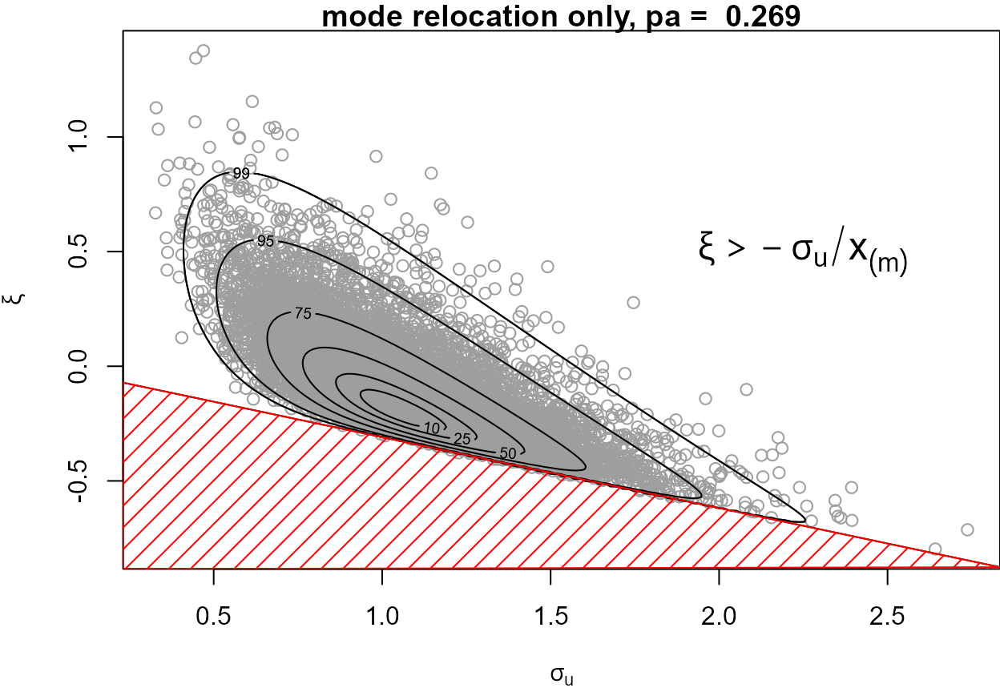
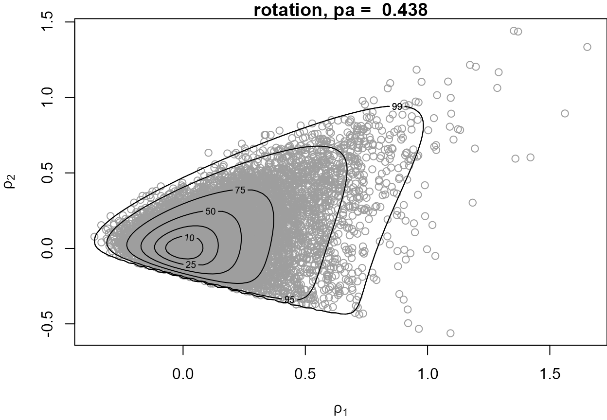
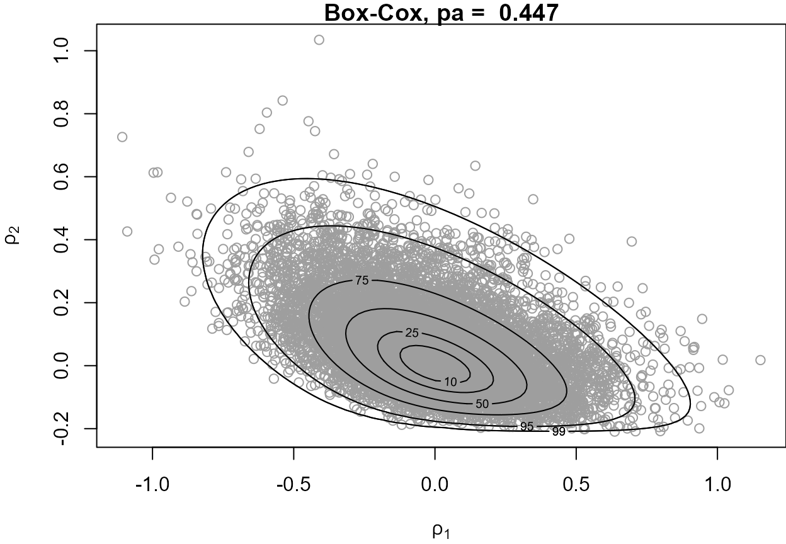
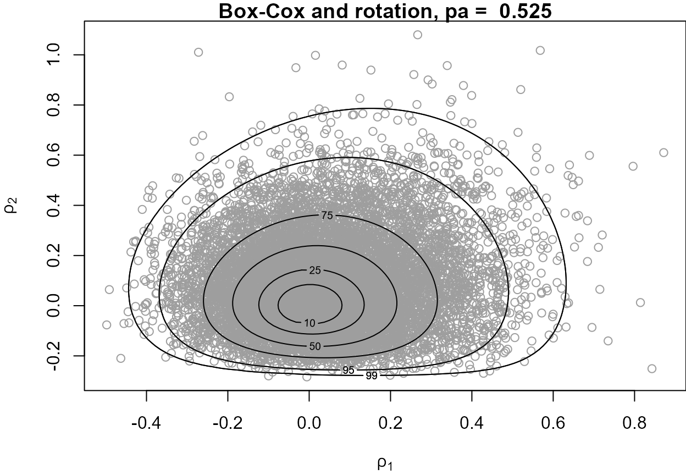

# EVA 2021 R Workshop: revdbayes

## How did revdbayes start?

- I needed to sample **quickly and automatically** from many EV
  (generalised Pareto) posteriors\
- [threshr](https://cran.r-project.org/package=threshr): threshold
  selection based on
  - out-of-sample EV predictions
  - leave-one-out cross-validation
- wanted to account for parameter uncertainty
- wanted to avoid MCMC tuning and convergence diagnostics

## What does revdbayes do?

- Direct sampling from (simple) EV posterior distributions
- Has similar functionality to
  [evdbayes](https://cran.r-project.org/package=evdbayes)

|          | evdbayes                        | revdbayes               |
|:---------|:--------------------------------|:------------------------|
| method   | Markov chain Monte Carlo (MCMC) | ratio-of-uniforms (ROU) |
| tuning   | required                        | largely automatic       |
| sample   | dependent                       | random                  |
| checking | yes                             | no                      |

## Ratio-of-uniforms method

\\d\\-dimensional continuous \\X = (X_1, \ldots, X_d)\\ with density
\\\propto\\ \\f(x)\\

If \\(u, v_1, \ldots, v_d)\\ are uniformly distributed over

\\ C(r) = \left\\ (u, v_1, \ldots, v_d): 0 \< u \leq \left\[ f\left(
\frac{v_1}{u^r}, \ldots, \frac{v_d}{u^r} \right) \right\] ^ {1/(r d +
1)} \right\\ \\

for some \\r \geq 0\\, then \\(v_1 / u ^r, \ldots, v_d / u ^ r)\\ has
density \\f(x) / \int f(x) {\rm ~d}x\\

**Acceptance-rejection algorithm**

- simulate uniformly over a \\(d+1)\\-dimensional bounding box \\\\ 0 \<
  u \leq a(r), \\ b_i^-(r) \leq v_i \leq b_i^+(r), \\ i = 1, \ldots, d
  \\\\
- if simulated \\(u, v_1, \ldots, v_d) \in C(r)\\ then accept \\x = (v_1
  / u ^r, \ldots, v_d / u ^ r)\\

**Limitations**

- \\f\\ must be bounded
- \\C(r)\\ must be ‘boxable’

## Increasing efficiency

\\ p_a(d, r) = \frac{\int f(x) {\rm ~d}x}{(r d + 1) \\ a(r)
\displaystyle\prod\_{i=1}^d \left\[b_i^+(r) -b_i^-(r) \right\]} \\

- **Relocate the mode to zero** (hard-coded into rust)
- **Choice of \\r\\** (\\r = 1/2\\ optimal for zero-mean normal)
- **Rotation** (\\d \> 1\\): the weaker the association the better
- **Transformation**: symmetric better than asymmetric

(EV posteriors can exhibit strong dependence and asymmetry)

- [rust](https://paulnorthrop.github.io/rust/) R package
- [Introduction to
  rust](https://paulnorthrop.github.io/rust/articles/rust-a-vignette.html)
  vignette

## Acceptance region for N(10, 1)

## [R exercises 1](https://paulnorthrop.github.io/revdbayes/articles/ex1revdbayes.html)

- 1D normal
- 1D log-normal
- 2D normal
- 1D gamma

For fun!

Can you find simple (1D) examples that throw

- a warning?
- an error?

Use [`?Distributions`](https://rdrr.io/r/stats/Distributions.html) for
possibilities

## Summary of ROU and rust

- Can be useful for
  - suitable low-dimensional distributions
  - for which a bespoke method does not exist
- Box-Cox transformation requires positive variable(s)
  - to do: generalise to Yeo-Johnson transformation
- Cannot be used in all cases
  - unbounded densities: perhaps OK after transformation
  - heavy tails: choose \\r\\ appropriately and/or transform
  - multi-modal: OK in theory, but need to find global optima

See [When can rust be
used?](https://paulnorthrop.github.io/rust/articles/rust-b-when-to-use-vignette.html)

## Bayesian EV analyses

- **Prior** \\\pi(\theta)\\ for model parameter vector \\\theta\\
- **Likelihood** \\L(\theta \mid \mbox{data})\\
- **Posterior** \\\pi(\theta \mid \mbox{data})\\ via Bayes’ theorem \\
  \pi(\theta \mid \mbox{data}) = \frac{L(\theta \mid \mbox{data})
  \pi(\theta)}{P(\mbox{data})} = \frac{L(\theta \mid \mbox{data})
  \pi(\theta)}{\int L(\theta \mid \mbox{data}) \pi(\theta)
  \\\mbox{d}\theta} \\
- Simulate a large sample from \\\pi(\theta \mid \mbox{data})\\, often
  using MCMC

### In revdbayes

- 4 standard univariate models: GEV, OS, GP, PP
- Simplest, i.i.d. case

## GP model for threshold excesses 1

Negative association + asymmetry \\\phantom{\xi + \sigma / x\_{(m)}}\\

## GP model for threshold excesses 2

Rotation about the MAP estimate based on the Hessian at the MAP
\\\phantom{\xi + \sigma / x\_{(m)}}\\

## GP model for threshold excesses 3

Box-Cox transformations of \\\phi_1 = \sigma_u \> 0\\ and \\\phi_2 =
\xi + \sigma / x\_{(m)} \> 0\\

## GP model for threshold excesses 4

Box-Cox first then rotate \\\phantom{\xi + \sigma / x\_{(m)}}\\

## Other models in revdbayes

- GEV for block (annual?) maxima
- Order statistics (OS): largest \\k\\ observations per block
- Non-homogeneous point process (PP) for threshold exceedances
  - approximates binomial for threshold exceedance and GP for excesses
  - GEV parameterisation: \\(\mu, \sigma, \xi)\\
  - choice of block length affects posterior sampling efficiency

## [R exercises 2](https://paulnorthrop.github.io/revdbayes/articles/ex2revdbayes.html)

- **GP** and **binomial-GP**
  - compare ROU posterior sampling approaches
  - posterior predictive model checking
  - predictive inference
- **PP**: sampling efficiently from the posterior
- **GEV**: compare `revdbayes` and `evdbayes`

Options to experiment

- changing threshold
- playing with function arguments

## Reflections

**Limitations**

- Very simple EV models
- ROU efficiency drops with number of parameters

**Current uses**

- [threshr](https://paulnorthrop.github.io/threshr/) Threshold Selection
  and Uncertainty for Extreme Value Analysis
- [mev](https://cran.r-project.org/package=mev)
  - `lambdadep()`: a bivariate dependence function (many posterior
    samples required)
  - `tstab.gpd()`: threshold stability plot
- [Estimation of the extremal
  index](https://cran.r-project.org/web/packages/revdbayes/vignettes/revdbayes-d-kgaps-vignette.html)
  using the \\K\\-gaps model

## Resources

- [rust](https://paulnorthrop.github.io/rust/)
  - [Introduction](https://paulnorthrop.github.io/rust/articles/rust-a-vignette.html)
  - [When can rust be
    used?](https://paulnorthrop.github.io/revdbayes/articles/revdbayes-a-vignette.html)
  - [Wakefield et al. (1991)](https://doi.org/10.1007/BF01889987)
    Efficiency of the ROU method
- [revdbayes](https://paulnorthrop.github.io/revdbayes/)
  - [Introduction](https://paulnorthrop.github.io/revdbayes/articles/revdbayes-a-vignette.html)
  - [Posterior predictive
    inference](https://paulnorthrop.github.io/revdbayes/articles/revdbayes-a-vignette.html)
  - [Stephenson (2016)](https://doi.org/10.1201/b19721) Bayesian EV
    analysis review
  - [Northrop and Attalides (2016)](https://doi.org/10.5705/ss.2014.034)
    Certain improper priors should not be used!
- [threshr](https://paulnorthrop.github.io/threshr/)
  - [Introduction](https://paulnorthrop.github.io/threshr/articles/threshr-vignette.html)
