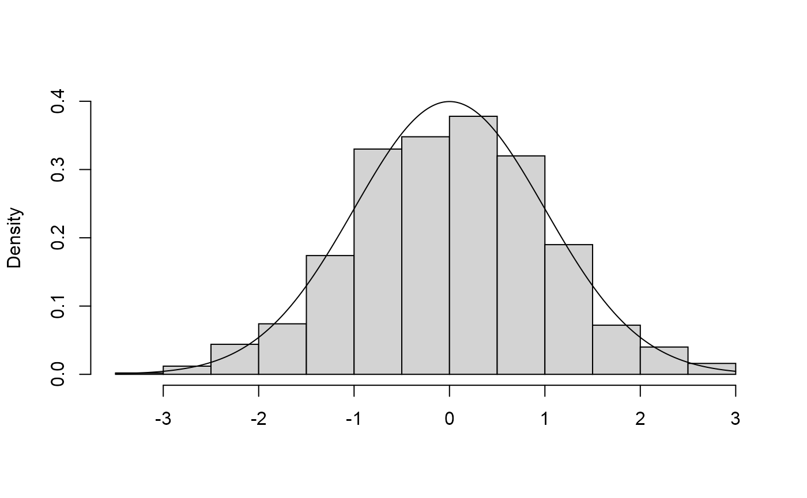
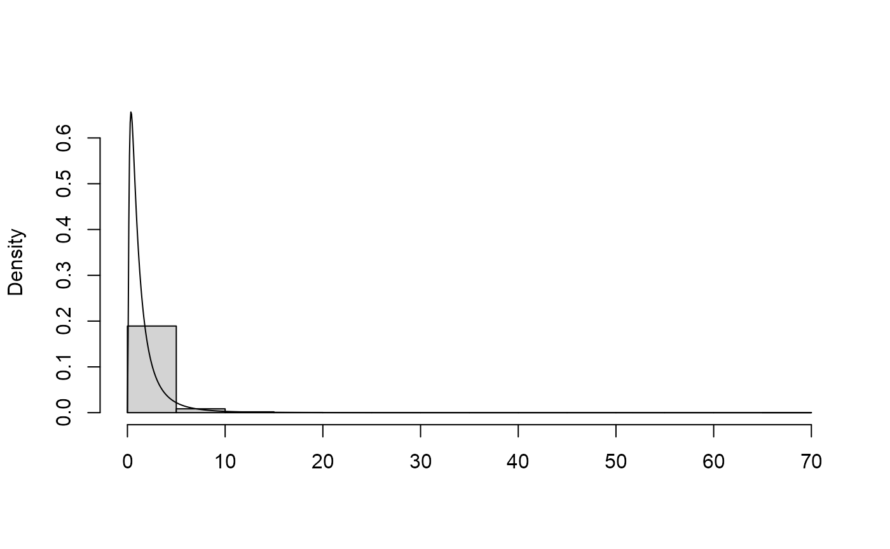
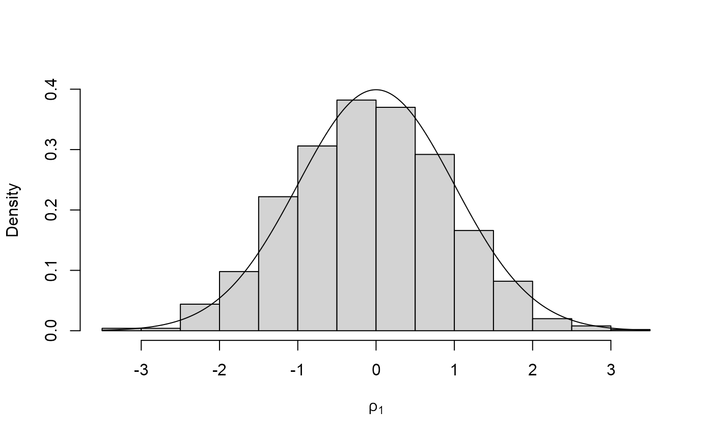
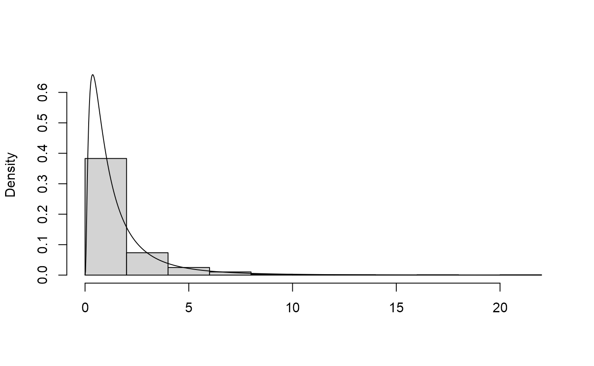
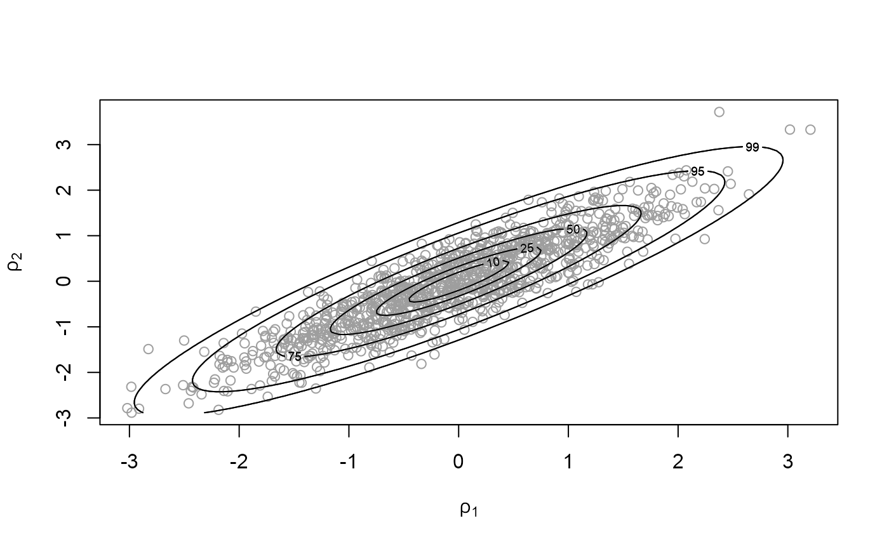
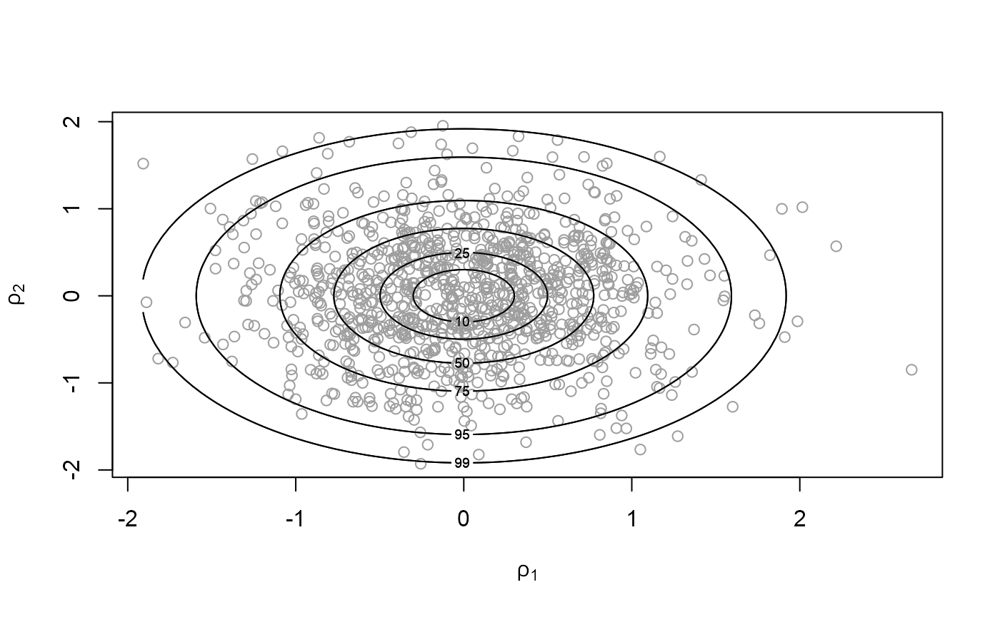
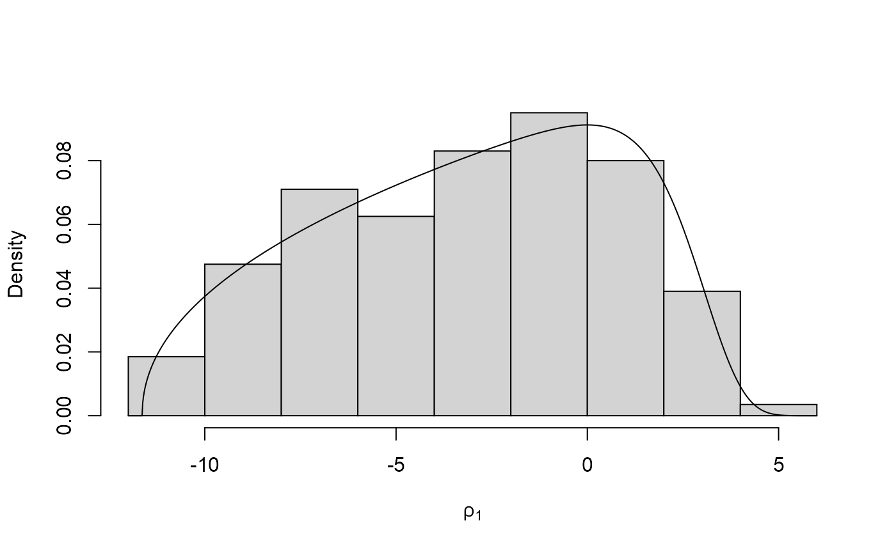

# EVA 2021 revdbayes exercises 1

## Getting started

- Install [RStudio
  Desktop](https://www.rstudio.com/products/rstudio/download/#download)
  (if you do not already have it) and open it
- Save
  [ex1revdbayes.Rmd](https://raw.githubusercontent.com/paulnorthrop/revdbayes/master/vignettes/ex1revdbayes.Rmd)
  to your computer (there is also a link to it above)
- Open `ex1revdbayes.Rmd` in Rstudio
- The R code is arranged in *chunks* highlighted in grey
- You can run the code in a chunk by clicking on the **green triangle**
  on the top right of the chunk
- There is information about Exercises 1 (and Exercises 2) in the
  [EVA2021 revdbayes
  slides](https://paulnorthrop.github.io/revdbayes/articles/EVA2021revdbayes.html)

## Aims

- Show the ROU method in action
- Use rotation and transformation to
  - increase the probability of acceptance
  - enable the ROU to be used in otherwise unsuitable cases

There is further information in the [Introduction to
rust](https://paulnorthrop.github.io/rust/articles/rust-a-vignette.html)
vignette.

``` r

# We need the rust and mvtnorm packages
pkg <- c("rust", "mvtnorm")
pkg_list <- pkg[!pkg %in% installed.packages()[, "Package"]]
install.packages(pkg_list)
# Load both packages
invisible(lapply(pkg, library, character.only = TRUE))
```

``` r

# Information about the ru() function
?ru

# Simulation sample size
n <- 1000
```

## 1D normal

``` r

# By default r = 1/2
# init is an initial estimate of the mode of logf
x1 <- ru(logf = dnorm, log = TRUE, d = 1, n = n, init = 0.1)
x1$pa
```

    ## [1] 0.7949126

``` r

plot(x1)
```



``` r

# r = 1 will be slightly less efficient
x2 <- ru(logf = dnorm, log = TRUE, d = 1, n = n, init = 0.1, r = 1)
x2$pa
```

    ## [1] 0.7575758

## 1D log-normal

``` r

# lower = 0 tells ru() that the log-normal is bounded below at 0
x1 <- ru(logf = dlnorm, log = TRUE, d = 1, n = n, lower = 0, init = 1)
x1$pa
```

    ## [1] 0.5595971

``` r

plot(x1)
```



``` r

# We know that ln(X) is normal.  
# First transform using a Box-Cox transformation with lambda=0 then simulate
lambda <- 0
x2 <- ru(logf = dlnorm, log = TRUE, d = 1, n = n, init = 0.1, trans = "BC",
         lambda = lambda)
x2$pa
```

    ## [1] 0.7898894

``` r

# Plot the (normal) distribution from which we have simulated using ROU 
plot(x2, ru_scale = TRUE)
```



``` r

# A check that the inverse (exponential) transformation has been applied
plot(x2)
```



## 2D normal

``` r

# two-dimensional normal with positive association ----------------
rho <- 0.9
covmat <- matrix(c(1, rho, rho, 1), 2, 2)
x1 <- ru(logf = mvtnorm::dmvnorm, sigma = covmat, log = TRUE, d = 2, n = n, 
         init = c(0, 0), rotate = FALSE)
x2 <- ru(logf = mvtnorm::dmvnorm, sigma = covmat, log = TRUE, d = 2, n = n, 
         init = c(0, 0), rotate = TRUE)
c(x1$pa, x2$pa)
```

    ## [1] 0.2331546 0.5271481

``` r

plot(x1, ru_scale = TRUE)
```



``` r

plot(x2, ru_scale = TRUE)
```



## 1D gamma

``` r

# Exponential case, with strong skewness
# A cube root transformation results in approximate symmetry
alpha <- 1
x1 <- ru(logf = dgamma, shape = alpha, log = TRUE, d = 1, n = n, trans = "BC",
       lambda = 1/3, init = alpha)
x1$pa
```

    ## [1] 0.8012821

``` r

# If alpha < 1 then the gamma density is extremely skewed and unbounded at 0
# A transformation can avoid this, but it needs to be stronger than a cube root
alpha <- 0.1
x2 <- ru(logf = dgamma, shape = alpha, log = TRUE, d = 1, n = n, trans = "BC",
         lambda = 0.068, init = 0)
x2$pa
```

    ## [1] 0.7662835

``` r

plot(x2)
```


``` r

plot(x2, ru_scale = TRUE)
```



## Can you break rust?

``` r

# Pick a standard distribution
?Distributions
# Change dnorm to a d???? of your choice below
# Perhaps also set lower, upper or init
x <- ru(logf = dnorm, log = TRUE, n = n)
```

    ## Warning in ru(logf = dnorm, log = TRUE, n = n): No initial estimate of the mode given: a vector of ones has
    ##             been used
