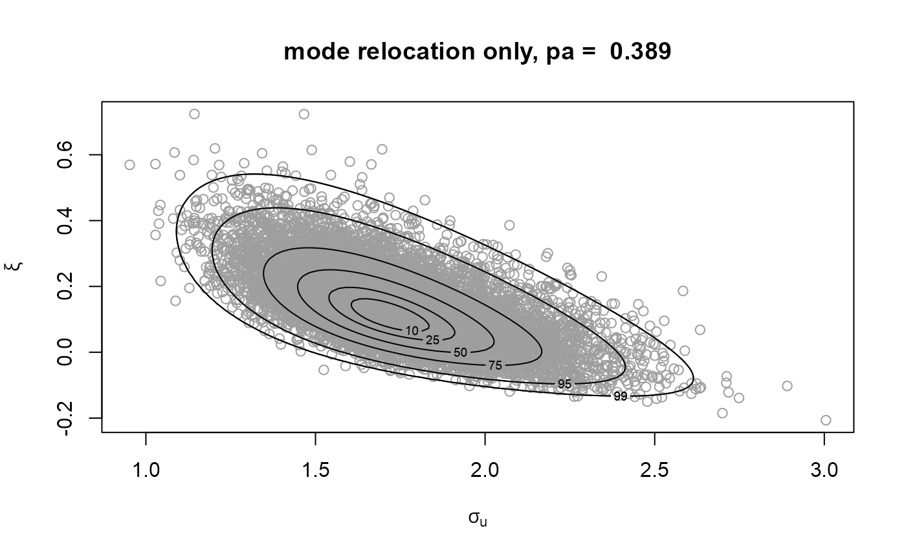
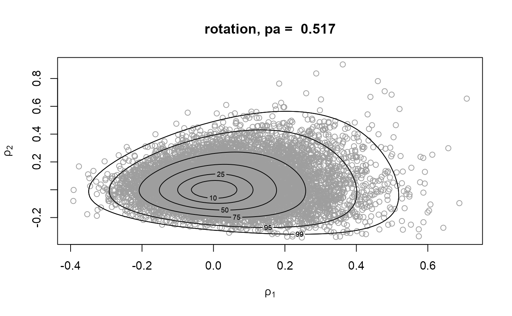
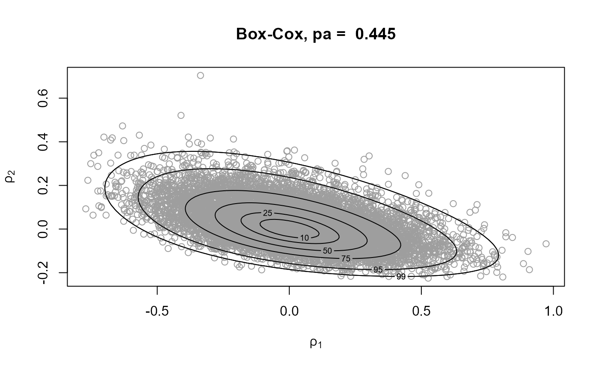
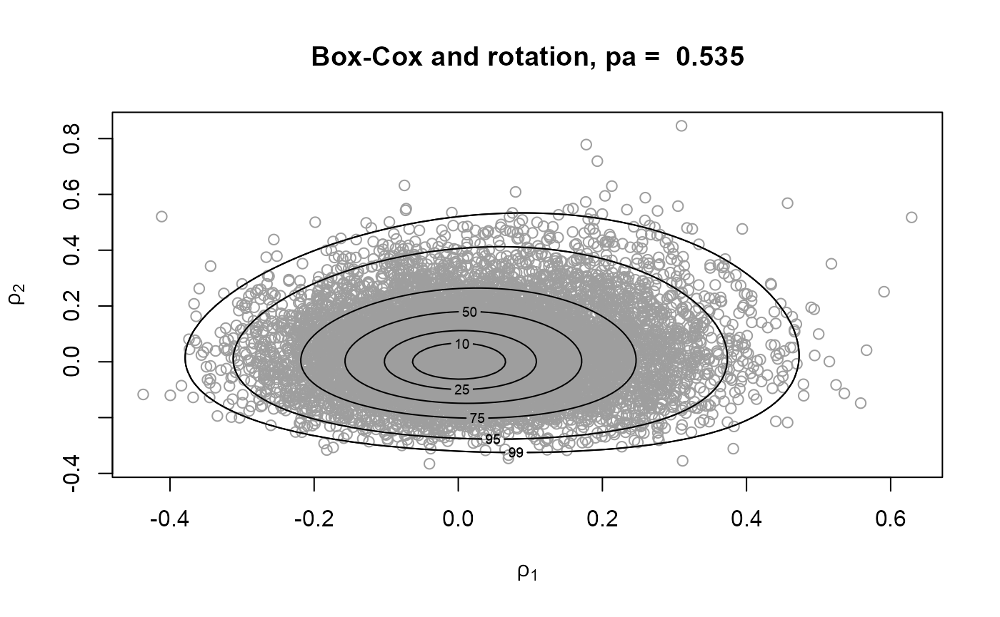
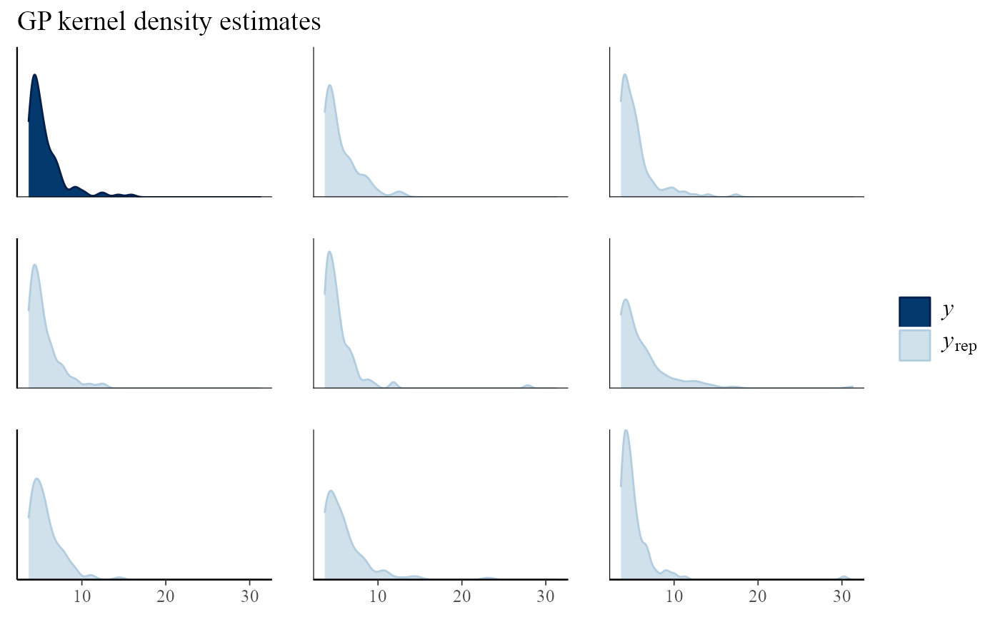
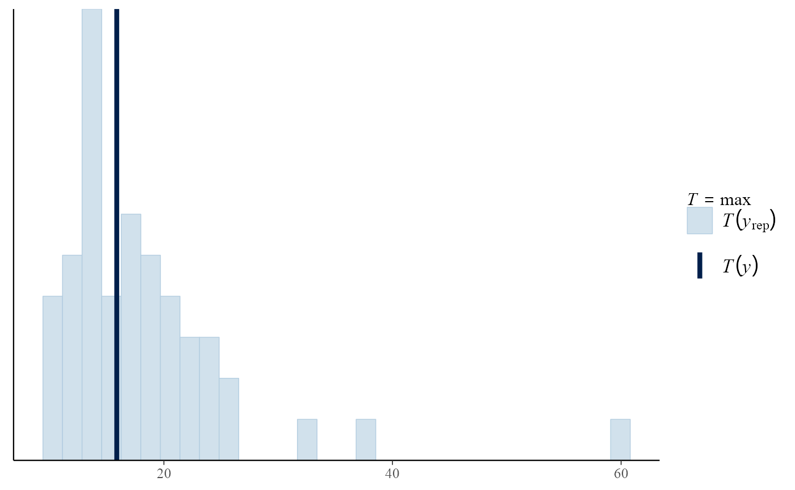
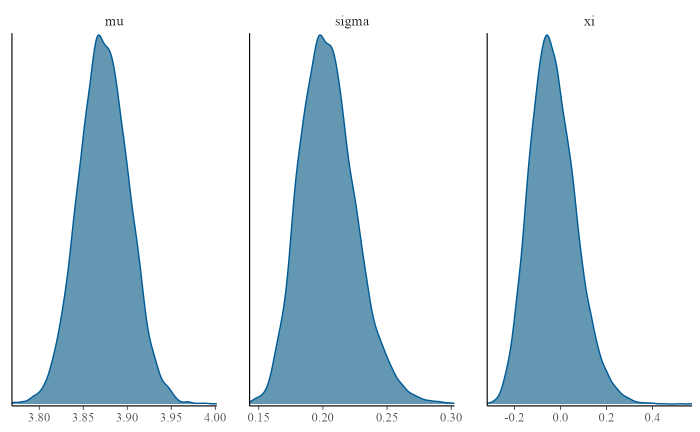
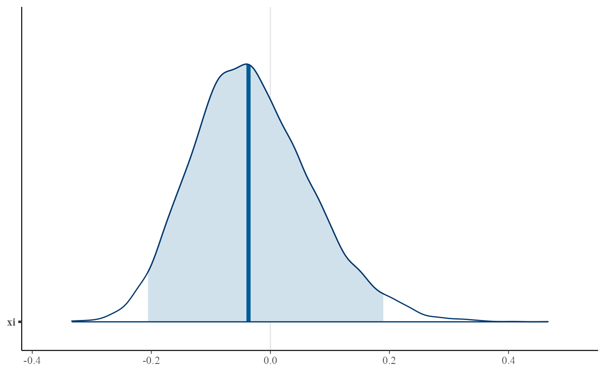
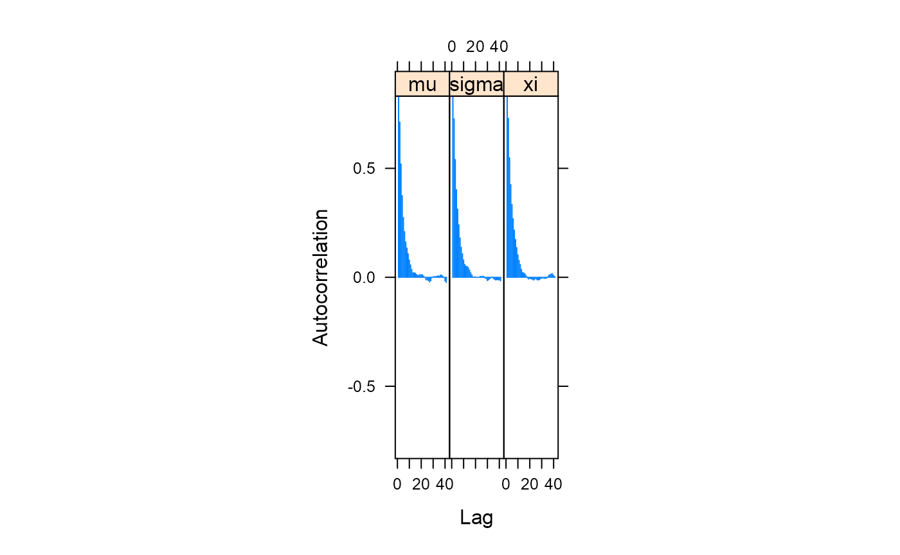

# EVA 2021 revdbayes exercises 2

## Getting started

- Install [RStudio
  Desktop](https://www.rstudio.com/products/rstudio/download/#download)
  (if you do not already have it) and open it
- Save
  [ex2revdbayes.Rmd](https://raw.githubusercontent.com/paulnorthrop/revdbayes/master/vignettes/ex2revdbayes.Rmd)
  to your computer (there is also a link to it above)
- Open `ex2revdbayes.Rmd` in Rstudio
- The R code is arranged in *chunks* highlighted in grey
- You can run the code in a chunk by clicking on the **green triangle**
  on the top right of the chunk
- There is information about Exercises 2 (and Exercises 1) in the
  [EVA2021 revdbayes
  slides](https://paulnorthrop.github.io/revdbayes/articles/EVA2021revdbayes.html)

## Aims

- Compare ROU approaches for sampling from a GP posterior
- Perform posterior predictive checking and inference
- Consider how to sample efficiently from a PP posterior
- Compare `revdbayes` and `evdbayes` for sampling from a GEV posterior

There is further information in the [Introduction to
revdbayes](https://paulnorthrop.github.io/revdbayes/articles/revdbayes-a-vignette.html)
vignette.

``` r

# We need the evdbayes, revdbayes, ggplot2, bayesplot and coda packages
pkg <- c("evdbayes", "revdbayes", "ggplot2", "bayesplot", "coda")
pkg_list <- pkg[!pkg %in% installed.packages()[, "Package"]]
install.packages(pkg_list)
```

    ## package 'evdbayes' successfully unpacked and MD5 sums checked
    ## package 'coda' successfully unpacked and MD5 sums checked
    ## 
    ## The downloaded binary packages are in
    ##  C:\Users\Paul\AppData\Local\Temp\Rtmps35WdN\downloaded_packages

``` r

# Load all packages
invisible(lapply(pkg, library, character.only = TRUE))
```

``` r

# Simulation sample size
n <- 10000
```

## GP model for threshold excesses

### GP priors

``` r

# Information about the set_prior() function
# You can choose from a set of options, or create your own
?set_prior
# Set the threshold
u <- quantile(gom, probs = 0.65)
# Set an 'uninformative' prior for the GP parameters
fp <- set_prior(prior = "flat", model = "gp", min_xi = -1)
```

### GP posteriors

``` r

# Information about the rpost function
?rpost
# Information about the gom (significant wave heights) data
?gom
# Sample on (sigma_u, xi) scale
gp1 <- rpost(n = n, model = "gp", prior = fp, thresh = u, data = gom,
             rotate = FALSE)
# Rotation
gp2 <- rpost(n = n, model = "gp", prior = fp, thresh = u, data = gom)
# Box-Cox transformation (after transformation to positivity)
gp3 <- rpost(n = n, model = "gp", prior = fp, thresh = u, data = gom,
             rotate = FALSE, trans = "BC")
# Box-Cox transformation and then rotation
gp4 <- rpost(n = n, model = "gp", prior = fp, thresh = u, data = gom,
             trans = "BC")
```

### Comparing approaches

``` r

# Samples and posterior density contours
plot(gp1, main = paste("mode relocation only, pa = ", round(gp1$pa, 3)))
```



``` r

plot(gp2, ru_scale = TRUE, main = paste("rotation, pa = ", round(gp2$pa, 3)))
```



``` r

plot(gp3, ru_scale = TRUE, main = paste("Box-Cox, pa = ", round(gp3$pa, 3)))
```



``` r

plot(gp4, ru_scale = TRUE, main = paste("Box-Cox and rotation, pa = ",
                                        round(gp4$pa, 3)))
```



[`rpost_rcpp()`](https://github.com/paulnorthrop/revdbayes/reference/rpost_rcpp.md)
is faster than
[`rpost()`](https://github.com/paulnorthrop/revdbayes/reference/rpost.md).
See the [rusting
faster](https://cran.r-project.org/web/packages/revdbayes/vignettes/revdbayes-b-using-rcpp-vignette.html)
vignette.

``` r

gp2 <- rpost_rcpp(n = n, model = "gp", prior = fp, thresh = u, data = gom)
```

Suggestion: increase the threshold and see how the appearance of the
posterior changes.

## Posterior predictive checking

There is further information in the [Posterior predictive EV
inference](https://paulnorthrop.github.io/revdbayes/articles/revdbayes-c-predictive-vignette.html)
vignette.

``` r

# nrep = 50 asks for 50 fake replicates of the original data
# For each of 50 posterior samples of the parameters a dataset is simulated 
gpg <- rpost(n = n, model = "gp", prior = fp, thresh = u, data = gom, 
             nrep = 50)
# Information about pp_check.evpost
?pp_check.evpost
# Compare real and fake datasets
pp_check(gpg, type = "multiple", subtype = "dens") + ggtitle("GP kernel density estimates")
```



``` r

# Compare real and fake summary statistics
pp_check(gpg, stat = "max")
```

    ## `stat_bin()` using `bins = 30`. Pick better value `binwidth`.



- Would you be able to spot the real dataset or summary statistic if it
  was not highlighted?
- Option: you could play with the arguments
  - `type` and/or `subtype` for the first plot
  - `stat` for the second plot

## Posterior predictive EV inference

### Binomial-GP model for threshold exceedances

Modelling threshold excesses is only part of the story. We also need to
model the proportion of observations that exceed the threshold.

``` r

bp <- set_bin_prior(prior = "jeffreys")
# We need to provide the mean number of observations per year 
# The data cover a period of 105 years
npy_gom <- length(gom)/105
bgpg <- rpost(n = 1000, model = "bingp", prior = fp, thresh = u, data = gom,
              bin_prior = bp, npy = npy_gom, nrep = 50)
```

We can make predictive inferences about the largest value \\M_N\\ to be
observed over a time horizon of \\N\\ years.

``` r

# Information about pp_check.evpost
?predict.evpost
# Predictive density of the largest value in `n_years' years
plot(predict(bgpg, type = "d", n_years = 200))
```


``` r

# Predictive intervals (equi-tailed and shortest possible)
i_bgpp <- predict(bgpg, n_years = 200, level = c(95, 99), hpd = TRUE)
plot(i_bgpp, which_int = "both")
```


    ## Warning in graphics::par(u): argument 1 does not name a graphical parameter

``` r

i_bgpp$short 
```

    ##          lower    upper n_years level
    ## [1,] 10.315968 39.90904     200    95
    ## [2,]  9.396545 73.17092     200    99

``` r

# The predictive 100, 200 and 500 year return levels 
predict(bgpg, type = "q", n_years = 1, x = c(0.99, 0.995, 0.998))$y
```

    ##          [,1]
    ## [1,] 15.22621
    ## [2,] 18.09992
    ## [3,] 22.97870

See [Northrop and Attalides (2017)](https://doi.org/10.1111/rssc.12159)
for an analysis of these data using an informative prior.

## PP model for threshold exceedances

We compare three ways to sample from a PP posterior distribution

1.  Parameterise in terms of annual maxima
2.  [Wadsworth et al. (2010)](https://doi.org/10.1214/10-AOAS333):
    parameterise to make \\\mu\\ orthogonal to \\(\sigma, \xi)\\
3.  Empirical rotation to reduce association

``` r

# Information about the rainfall data
?revdbayes::rainfall
# Set a threshold and use the prior from the evdbayes user guide
rthresh <- 40
prrain <- evdbayes::prior.quant(shape = c(38.9,7.1,47), scale = c(1.5,6.3,2.6))
```

``` r

# 1. Number of blocks = number of years of data (54)
r1 <- rpost(n = n, model = "pp", prior = prrain, data = rainfall,
            thresh = rthresh, noy = 54, rotate = FALSE)
plot(r1)
```


``` r

# 2. Number of blocks = number of threshold excesses (use_noy = FALSE)
n_exc <- sum(rainfall > rthresh, na.rm = TRUE)
r2 <- rpost(n = n, model = "pp", prior = prrain, data = rainfall, 
            thresh = rthresh, noy = 54, use_noy = FALSE, rotate = FALSE)
plot(r2, ru_scale = TRUE)
```


``` r

# 3. # Rotation about maximum a posteriori estimate (MAP)
r3 <- rpost(n = n, model = "pp", prior = prrain, data = rainfall, 
            thresh = rthresh, noy = 54)
plot(r3, ru_scale = TRUE)
```


``` r

c(r1$pa, r2$pa, r3$pa)
```

    ## [1] 0.1717003 0.1936333 0.2988375

- Based on the plots, which approach do you expect to have the largest
  probability of acceptance?
- Is this what you see in the values of `r1$pa`, `r2$pa` and `r3$pa`?

## GEV model for block maxima

``` r

# Information about the portpirie data
?revdbayes::portpirie
# Use the prior from the evdbayes user guide
mat <- diag(c(10000, 10000, 100))         
pn <- set_prior(prior = "norm", model = "gev", mean = c(0, 0, 0), cov = mat)
```

### revdbayes

``` r

mat <- diag(c(10000, 10000, 100))
gevp  <- rpost_rcpp(n = n, model = "gev", prior = pn, data = portpirie)
# Information about plot.evpost
?plot.evpost
# Can use the plots from the bayesplot package
plot(gevp, use_bayesplot = TRUE, fun_name = "dens")
```



``` r

plot(gevp, use_bayesplot = TRUE, pars = "xi", prob = 0.95)
```



### evdbayes

``` r

# evdbayes has a function ar.choice to help set the proposal SDs
# It does this by searching for values that achieve approximately
# target values for the acceptance rates (default 0.4 for all parameters)
?ar.choice
# Initialise evdbayes' Markov chain at the estimated posterior mean
init <- colMeans(gevp$sim_vals)
prop.sd.auto <- ar.choice(init = init, prior = pn, lh = "gev", 
                          data = portpirie, psd = rep(0.01, 3), 
                          tol = rep(0.02, 3))$psd
post <- posterior(n, init = init, prior = pn, lh = "gev", 
                  data = portpirie, psd = prop.sd.auto)
for (i in 1:3) plot(post[, i], ylab = c("mu","sigma","xi")[i]) 
```


``` r

post_for_coda <- coda::mcmc(post)
# Assuming no burn-in period
burnin <- 0                 
post_for_coda <- window(post_for_coda, start = burnin + 1)
# Trace plots and KDEs
plot(post_for_coda)
```


``` r

# The sampled values are autocorrelated
coda::acfplot(post_for_coda)
```



``` r

# Effective sample sizes (10,000 for revdbayes)
coda::effectiveSize(post_for_coda)
```

    ##       mu    sigma       xi 
    ## 1530.996 1418.982 1589.088

- In practice one would run multiple chains and use the Gelman-Rubin
  convergence diagnostic, e.g. `gelman.diag` in the `coda` package.
- The [Introduction to
  revdbayes](https://paulnorthrop.github.io/revdbayes/articles/revdbayes-a-vignette.html)
  shows that the posterior samples from `evdbayes` and `revdbayes` are
  in agreement.
