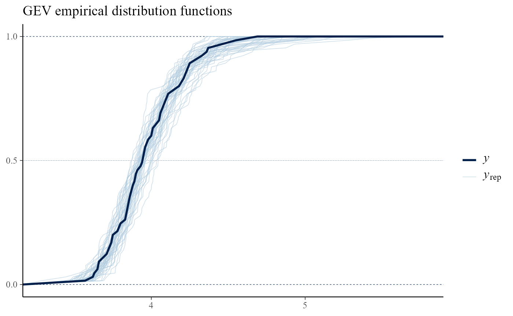
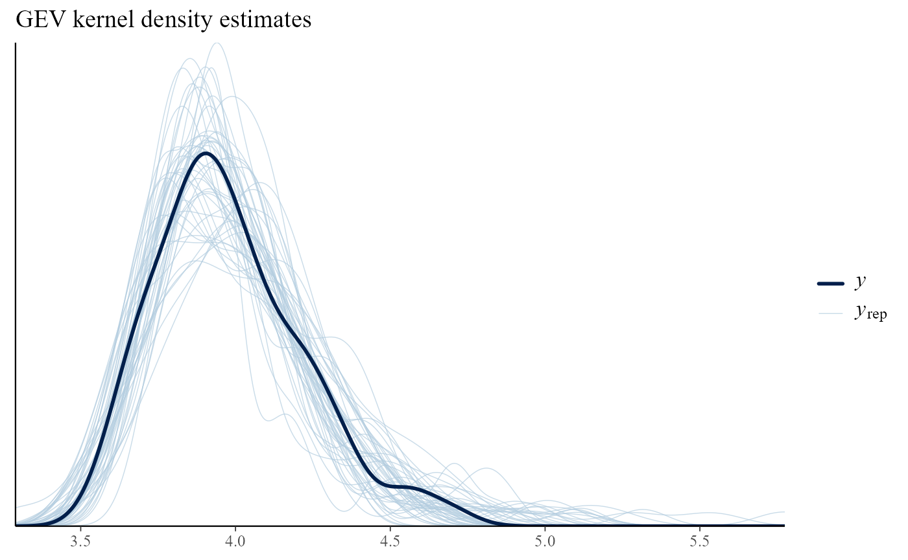
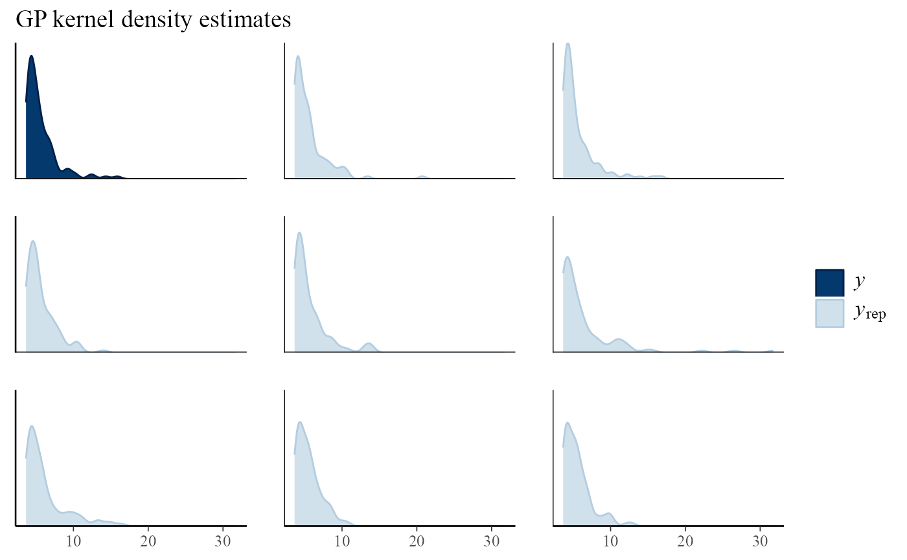
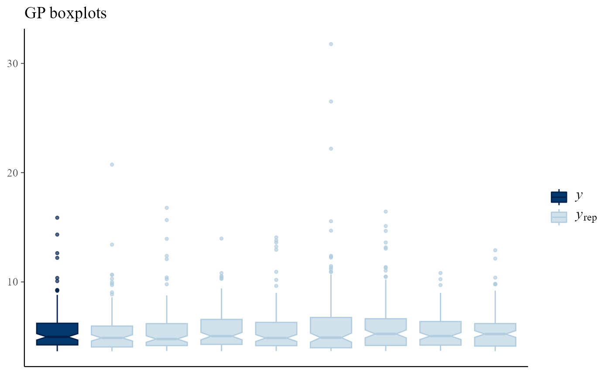
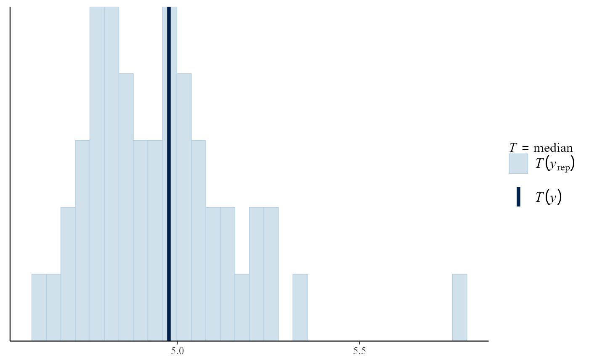
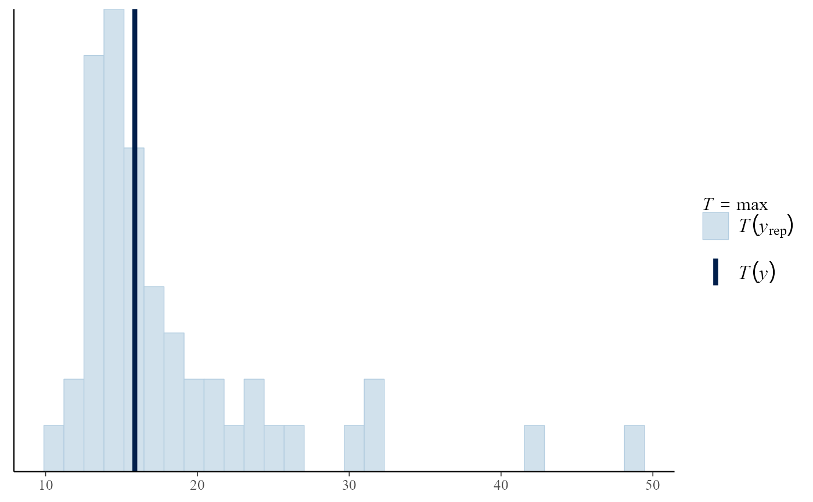
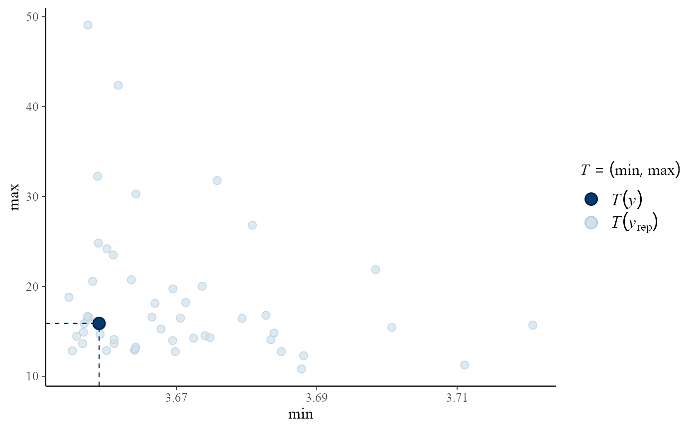
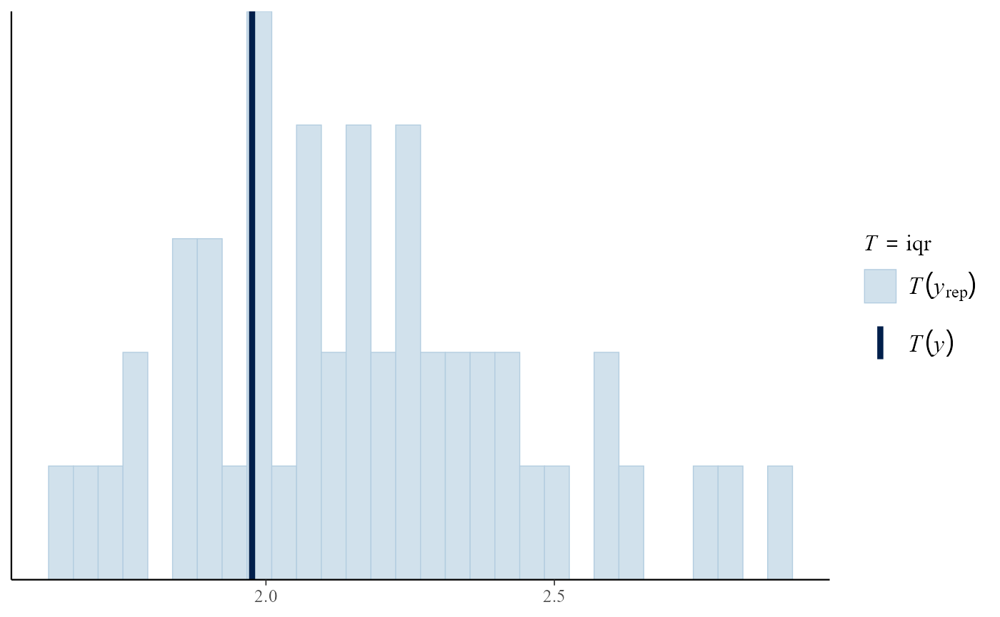
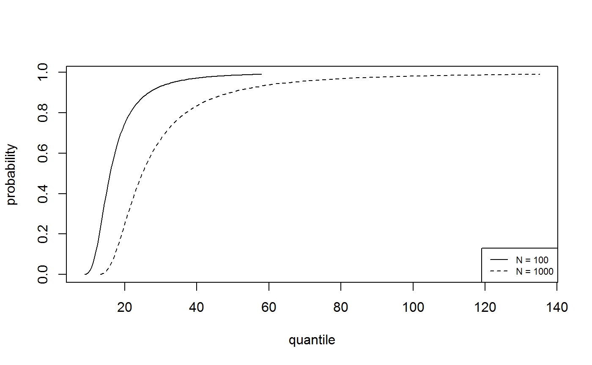
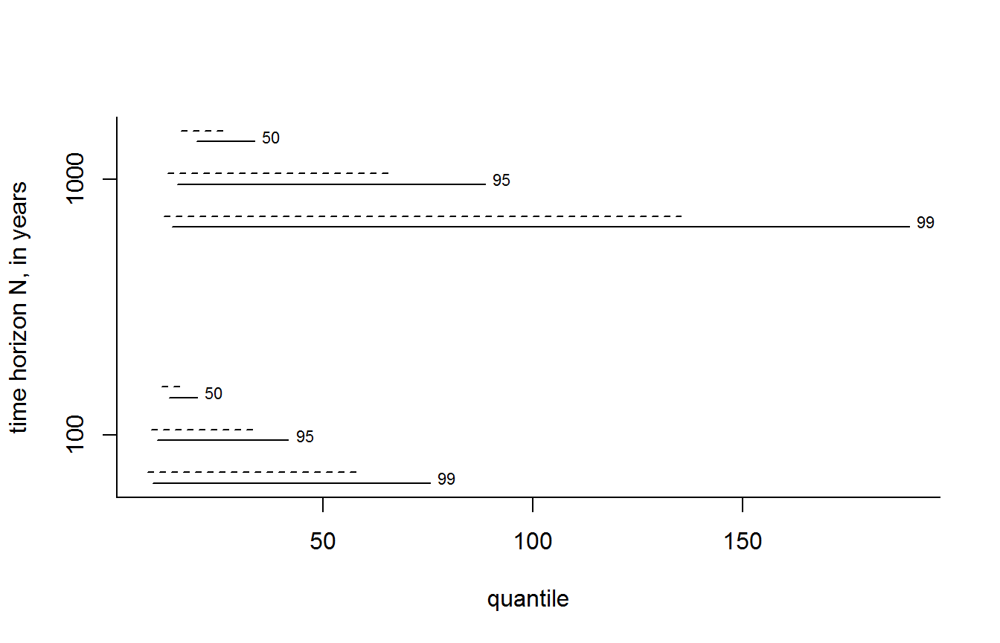

# Posterior Predictive Extreme Value Inference using the revdbayes Package

This vignette focuses on *posterior predictive inference* using extreme
value models. Posterior predictive inference is the prediction of
unobserved variables conditional on observed data, performed by
integrating parameter-specific inferences over a posterior distribution
for model parameters. In practice, the integration averaging is
performed using an empirical average based on samples from the posterior
distribution. The vignette [Introducing
revdbayes](https://github.com/paulnorthrop/revdbayes/articles/revdbayes-a-vignette.md)
covers the sampling from extreme value posterior distributions and the
vignette [Faster simulation using
revdbayes](https://github.com/paulnorthrop/revdbayes/articles/revdbayes-b-using-rcpp-vignette.md)
considers how to do this more quickly.

We consider two uses of posterior predictive inference. In the first we
simulate from the posterior predictive distribution many replicates of
the observed data. A comparison of these replicates to the observed data
provides a way to assess the fit of the model: systematic differences in
behaviour between the observed and replicated data suggest features of
the data that are not represented well by the model. For greater detail
see Chapter 6 of Gelman et al. (2014). Secondly, we define as the
variable of interest the largest value \\M_N\\ to be observed over a
future time period of length \\N\\ years and estimate under the extreme
value model the conditional distribution of \\M_N\\ given the observed
data. This accounts for uncertainty in model parameters and for
uncertainty owing to the variability of future observations.

We illustrate the code used to perform these two tasks using the
`portpirie` and `gom` datasets that feature in the vignette [Introducing
revdbayes](https://github.com/paulnorthrop/revdbayes/articles/revdbayes-a-vignette.md).

``` r

# Set the number of posterior samples required.
n <- 1000
set.seed(47)
library(revdbayes)
```

We produce posterior samples for later use. The argument `nrep = 50` to
`rpost` results in 50 simulated replicates of the data being returned in
`object$data_rep`.

``` r

### GEV model for Port Pirie Annual Maximum Sea Levels 
data(portpirie)
mat <- diag(c(10000, 10000, 100))
pn <- set_prior(prior = "norm", model = "gev", mean = c(0,0,0), cov = mat)
gevp  <- rpost(n = n, model = "gev", prior = pn, data = portpirie, nrep = 50)

### GP model for Gulf-of-Mexico significant wave heights
u <- quantile(gom, probs = 0.65)
fp <- set_prior(prior = "flat", model = "gp", min_xi = -1)
gpg <- rpost(n = 1000, model = "gp", prior = fp, thresh = u, data = gom, nrep = 50)
```

## Posterior predictive model checking

The `pp_check` method `pp_check.evpost` provides an interface to the
posterior predictive checking graphics available in the *bayesplot*
package (Gabry and Mahr 2017). For details see the bayesplot vignette
[Graphical posterior predictive
checks](https://CRAN.R-project.org/package=bayesplot). *bayesplot*
functions return a `ggplot` object that can be customised using the
*ggplot2* package (Wickham 2009).

``` r

library(bayesplot)
#> This is bayesplot version 1.15.0
#> - Online documentation and vignettes at mc-stan.org/bayesplot
#> - bayesplot theme set to bayesplot::theme_default()
#>    * Does _not_ affect other ggplot2 plots
#>    * See ?bayesplot_theme_set for details on theme setting
library(ggplot2)
```

We show three examples of the graphical posterior predictive checks that
are available from *bayesplot*.

### Overlaid density and distribution functions

Calling `pp_check` with `type = "overlaid"` produces plots in which
either the empirical distribution functions or kernel density estimates
of the observed and replicated data are compared. If the model fits well
then the observed data should look like a typical replication from the
posterior predictive distribution, which seems to be the case here.

``` r

# GEV
pp_check(gevp, type = "overlaid") + ggtitle("GEV empirical distribution functions")
pp_check(gevp, type = "overlaid", subtype = "dens") + ggtitle("GEV kernel density estimates")
```



### Multiple plots

Using `type = multiple` produces multiple plots, rather than overlaid
plots, with `subtype` indicating the type of plots to be drawn. By
default only 8 plots of replicated data are drawn, but this can be
changed using the `nrep` argument. Again, the plot of the observed data
is not obviously different from those of the replicated data.

``` r

pp_check(gpg, type = "multiple") + ggtitle("GP kernel density estimates")
pp_check(gpg, type = "multiple", subtype = "boxplot") + ggtitle("GP boxplots")
```



### Posterior predictive test statistics

The default setting for `pp_check` is to produce a plot that compares
the values of test statistics for the observed and replicated data. The
argument `stat` defines the test statistic (or a pair of test
statistics) to use, using either the name of a standard function or a
user-defined function. For a model that fits well the value of the
statistic calculated from the observed data should not be unusual
compared to the values calculated from the replicated data. In this
example, the plots do not suggest clear lack-of-fit.

``` r

pp_check(gpg)
#> `stat_bin()` using `bins = 30`. Pick better value `binwidth`.
pp_check(gpg, stat = "max")
#> `stat_bin()` using `bins = 30`. Pick better value `binwidth`.
pp_check(gpg, stat = c("min", "max"))
iqr <- function(y) diff(quantile(y, c(0.25, 0.75)))
pp_check(gpg, stat = "iqr")
#> `stat_bin()` using `bins = 30`. Pick better value `binwidth`.
```



## Posterior predictive extreme value inference

Posterior predictive inferences for the largest value \\M_N\\ to be
observed over a future time period of length \\N\\ years is performed by
the `predict` method for the objects of class `evpost` returned from
`rpost`. Objects returned from `predict.evpost` have class `evpred`. The
`plot` method for these objects produces graphical summaries of the
output from `predict`.

To perform predictive inference about \\M_N\\ we need to provide, or
assume, information about the timescale covered by the data. To do this
we need to supply the mean number `npy` of non-missing observations per
year, either in the call to `rpost` or the call to `predict`. For the
GEV and OS models it is often the case that the input data are annual
maxima, so `npy = 1` is the default value if `npy` is not supplied. For
the PP model a similar assumption is made: see the documentation for
`predict.evpost` for details. For the binomial-GP model (note that we
need the binomial part in order to account for the rate at which the
threshold is exceedance) `npy` must be provided by the user.

Let \\F\_{M_N}(z; \theta)\\ denote the distribution function of \\M_N\\
conditional on the parameters \\\theta\\ of an extreme value model and
let \\\pi(\theta \mid x)\\ be the posterior distribution of \\\theta\\
given the observed data. Then, if we assume that given \\\theta\\ future
observations are independent of the data \\x\\ then posterior predictive
distribution function of \\M_N\\ given only the data \\x\\ is given by
\\ P(M_N \leqslant z \mid x) = \int F\_{M_N}(z; \theta) \\ \pi(\theta
\mid x) {\rm ~d}\theta. \\ We estimate \\P(M_N \leqslant z)\\ using \\
\hat{P}(M_N \leqslant z \mid x) = \frac1m \sum\_{j=1}^m F\_{M_N}(z;
\theta_j), \\ where \\\theta_j, j=1, \ldots, m\\ is a sample from the
posterior distribution \\\pi(\theta \mid x)\\.

The form of \\F\_{M_N}(z; \theta)\\ depends on the extreme value model.
The GEV, OS and PP models are each parameterised by the location, scale
and shape parameters of a GEV distribution. Let \\G(z; \theta)\\ be the
GEV distribution function for an annual maximum under a given such
model, after appropriate adjustment for the value of `npy`. Then,
\\F\_{M_N}(z; \theta) = G(z; \theta)^{N}\\. For the binomial-GP model,
provided that \\z\\ is the greater than the threshold \\u\\,
\\F\_{M_N}(z; \theta) = F(z; \theta)^{n\_{py} N}\\, where \\n\_{py}\\ is
the value of `npy` and \\ F(z; \theta) = 1-p_u
\left\\1+\xi\left(\frac{z-u}{\sigma_u}\right)\right\\^{-1/\xi}. \\ See
Northrop, Attalides, and Jonathan (2017) for greater detail.

We repeat the posterior simulation for the Gulf-of-Mexico example,
changing `model = gp` to `model = bingp` in the call to `rpost` to add
inferences about the probability of threshold exceedance based on a
binomial distribution.

``` r

### Binomial-GP model for Gulf-of-Mexico significant wave heights
u <- quantile(gom, probs = 0.65)
fp <- set_prior(prior = "flat", model = "gp", min_xi = -1)
bp <- set_bin_prior(prior = "jeffreys")
# We need to provide the mean number of observations per year (the data cover a period of 105 years)
npy_gom <- length(gom)/105
bgpg <- rpost(n = 1000, model = "bingp", prior = fp, thresh = u, data = gom,
              bin_prior = bp, npy = npy_gom, nrep = 50)
```

### Posterior predictive density and distribution functions

We plot, for the analyses of the `portpirie` (GEV) and `gom`
(binomial-GP) datasets, the estimated posterior predictive density
functions and distributions functions of \\M_N\\ for \\N = 100\\ and \\N
= 1000\\. The argument `n_years` gives the value(s) of \\N\\.

``` r

# GEV (Portpirie)
plot(predict(gevp, type = "d", n_years = c(100, 1000)), cex = 0.7)
plot(predict(gevp, type = "p", n_years = c(100, 1000)), cex = 0.7)
```


``` r

# binGP (Gulf-of-Mexico)
plot(predict(bgpg, type = "d", n_years = c(100, 1000)), cex = 0.7)
plot(predict(bgpg, type = "p", n_years = c(100, 1000)), cex = 0.7)
```



As one would expect there is greater uncertainty for \\N=1000\\ than for
\\N=100\\. In making inferences over a period of length 1000 years a
large degree of uncertainty is to be expected. For the Gulf-of-Mexico
data in particular, this results in appreciable probability on values of
significant wave height thought by experts to be physically unrealistic.

### Posterior predictive intervals

The default setting for `predict.evpost` is to estimate posterior
predictive intervals for \\M_N\\. In addition to `n_years` we can
specify the probability level `level` of the interval(s), that is, the
estimated probability that \\M_N\\ lies within the interval. Two types
of interval can be calculated. One is an equi-tailed interval in which
the estimated probability that \\M_N\\ lies below the lower limit of the
interval is equal to the estimated probability that \\M_N\\ lies above
the upper limit of the interval. Typically, there will exist intervals
of the required probability level that is shorter than the equi-tailed
interval. `predict.evpost` can search for the shortest such interval. If
the estimated posterior predictive distribution is unimodal then this
interval is the *highest predictive density* (HPD) interval, with the
property that at all values inside the interval the estimated posterior
predictive density is greater than at all values outside the interval.
If `hpd = FALSE` then only equi-tailed intervals are returned. If
`hpd = TRUE` then both types of interval are returned.

The `plot.evpred` method plots the estimated posterior predictive
intervals for each value in `n_years` and each level in `level`. The
argument `which_int` controls which of the two types of interval are
included. The dashed lines give the HPD intervals and the solid lines
the equi-tailed intervals. Each line is labelled by the level of the
interval.

``` r

i_gevp <- predict(gevp, n_years = c(100, 1000), level = c(50, 95, 99), hpd = TRUE)
plot(i_gevp, which_int = "both")
```


    #> Warning in graphics::par(u): argument 1 does not name a graphical parameter
    i_bgpp <- predict(bgpg, n_years = c(100, 1000), level = c(50, 95, 99), hpd = TRUE)
    plot(i_bgpp, which_int = "both")



    #> Warning in graphics::par(u): argument 1 does not name a graphical parameter

## References

Gabry, Jonah, and Tristan Mahr. 2017. *Bayesplot: Plotting for Bayesian
Models*. <https://CRAN.R-project.org/package=bayesplot>.

Gelman, A., J. B. Carlin, Dunson Stern H. S., and D. B. Rubin. 2014.
*Bayesian Data Analysis*. Third edition. London: Chapman & Hall / CRC
Press.

Northrop, P. J., N. Attalides, and P. Jonathan. 2017. “Cross-Validatory
Extreme Value Threshold Selection and Uncertainty with Application to
Ocean Storm Severity.” *Journal of the Royal Statistical Society: Series
C (Applied Statistics)* 66 (1): 93–120.
doi:[10.1111/rssc.12159](https://doi.org/10.1111/rssc.12159).

Wickham, Hadley. 2009. *ggplot2: Elegant Graphics for Data Analysis*.
Springer-Verlag New York. <https://ggplot2.tidyverse.org/>.
