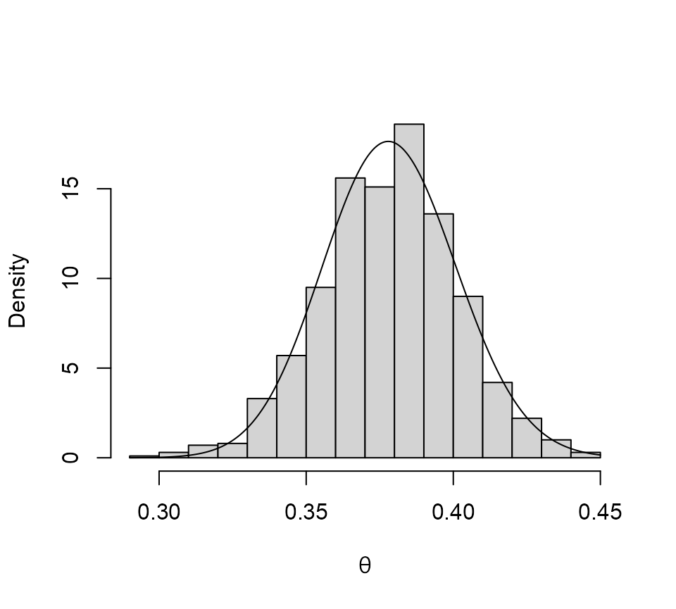

# Inference for the extremal index using threshold interexceedance times

The models considered in the [Introducing
revdbayes](https://github.com/paulnorthrop/revdbayes/articles/revdbayes-a-vignette.md)
vignette are based on the assumption that observations of a (univariate)
quantity of interest can be treated as independent and identically
distributed (iid) variates. In many instances these assumptions are
unrealistic. In this vignette we consider the situation when it is not
reasonable to make the former assumption, that is, temporal dependence
is present. In this circumstance a key issue is the strength of
dependence between extreme events. Under conditions that preclude
dependence between extreme events that occur far apart in time, the
effect of dependence is local in time, resulting in a tendency for
extreme to a occur in clusters. The most common measure of the strength
of local extremal dependence is the *extremal index* \\\theta\\. For a
review of theory and methods for time series extremes see
Chavez-Demoulin and Davison (2012).

## \\K\\-gaps and \\D\\-gaps models

The extremal index has several interpretations and leading to different
models/methods by which inferences about \\\theta\\ can be made. Here we
consider a model based on the behaviour of occurrences of exceedances of
a high threshold. The \\K\\-gaps model of Süveges and Davison (2010)
extends the model of Ferro and Segers (2003) by incorporating a *run
length* parameter \\K\\. Under this model threshold inter-exceedance
times not larger than \\K\\ are part of the same cluster and other
inter-exceedance times have an exponential distribution with rate
parameter \\\theta\\. Thus, \\\theta\\ has dual role as the probability
that a process leaves one cluster of threshold exceedances and as the
reciprocal of the mean time until the process enters the next cluster.
For details see Süveges and Davison (2010).

A related approach (Holesovsky and Fusek 2020), which we will call
\\D\\-gaps, involves a censoring parameter \\D\\. This estimator is
similar to the \\K\\-gaps estimator, but the treatment of small
inter-exceedance times is different. Threshold inter-exceedances times
that are not larger than units are left-censored and contribute to a
log-likelihood only the information that they are \\\leq D\\.

The **exdex** package (Northrop and Christodoulides 2022) packages
provides functions for performing maximum likelihood about \\\theta\\
under the \\K\\-gaps and \\D\\-gaps models.

## Bayesian Inference

We use the `newlyn` dataset, which is analysed in Fawcett and Walshaw
(2012). For the sake of illustration we use the default setting, \\K =
1\\, which may not be appropriate for these data. See Süveges and
Davison (2010) for discussion of this issue and for methodology to
inform the choice of \\K\\.

The function `kgaps_post` simulates a random sample from the posterior
distribution of \\\theta\\ based on a Beta(\\\alpha, \beta\\) prior. The
user can choose the values of \\\alpha\\ and \\\beta\\. The default
setting is \\\alpha = \beta = 1\\, that is, a U(0,1) prior for
\\\theta\\. See Attalides (2015) for further information and for a
methods for selecting the value of the threshold in this situation. The
plot produced below is is histogram of the sample from the posterior
with the posterior density superimposed.

``` r

library(revdbayes)
# Set a threshold at the 90% quantile
thresh <- quantile(newlyn, probs = 0.90)
postsim <- kgaps_post(newlyn, thresh, k = 1)
plot(postsim, xlab = expression(theta))
```



The function `dgaps_post` has the same functionality as `kgaps-post`,
except that the argument `k` is replaced by an argument `D`.

## References

Attalides, N. 2015. “Threshold-Based Extreme Value Modelling.” PhD
thesis, University College London.

Chavez-Demoulin, V., and A. C. Davison. 2012. “Modelling Time Series
Extremes.” *REVSTAT-Statistical Journal* 10 (1): 109–133.

Fawcett, L., and D. Walshaw. 2012. “Estimating Return Levels from
Serially Dependent Extremes.” *Environmetrics* 23 (3): 272–283.
doi:[10.1002/env.2133](https://doi.org/10.1002/env.2133).

Ferro, C. A. T., and J. Segers. 2003. “Inference for Clusters of Extreme
Values.” *Journal of the Royal Statistical Society: Series B
(Statistical Methodology)* 65 (2). Blackwell Publishing: 545–556.
doi:[10.1111/1467-9868.00401](https://doi.org/10.1111/1467-9868.00401).

Holesovsky, J. P., and M. Fusek. 2020. “Estimation of the Extremal Index
Using Censored Distributions.” *Extremes* 23: 197–213.
doi:[10.1007/s10687-020-00374-3](https://doi.org/10.1007/s10687-020-00374-3).

Northrop, P. J., and C. Christodoulides. 2022. *exdex: Estimation of the
Extremal Index*. <https://CRAN.R-project.org/package=exdex>.

Süveges, M., and A. C. Davison. 2010. “Model Misspecification in Peaks
over Threshold Analysis.” *The Annals of Applied Statistics* 4 (1):
203–221. doi:[10.1214/09-AOAS292](https://doi.org/10.1214/09-AOAS292).
